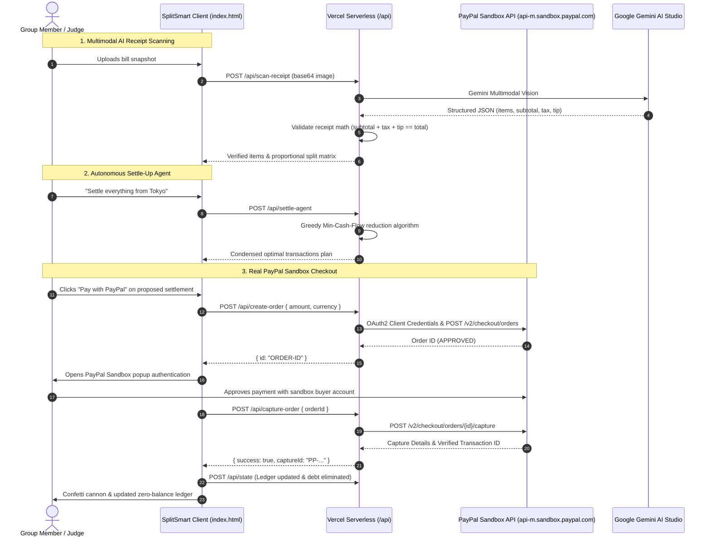

# ⚡ SplitSmart

> **Autonomous Agentic Social Finance, Dynamic Financial Avatars & Real PayPal Sandbox Settlements**  
> *Built for the [PayPal AI Hackathon](https://paypalaihackathon.devpost.com/) on Devpost.*


---

## 🎯 Overview

SplitSmart reimagines social expense sharing as an **Agentic Commerce Platform**:
1. **Real PayPal Sandbox Payments**: Zero mock balance tricks. Uses the official PayPal JavaScript SDK with server-side order creation (`/api/create-order`) and order capture (`/api/capture-order`). The client secret lives strictly on the server.
2. **Multimodal AI Receipt Scanner**: Upload any bill photo or receipt snapshot. Google Gemini multimodal vision extracts line items, subtotal, tax, and tip. An automated server-side mathematical verification engine checks that numbers balance before rendering.
3. **Autonomous Settle-Up Agent (Headline Feature)**: Tell the agent *"settle everything from Tokyo"* (or *"settle Goa trip"*). The AI agent computes the **Min-Cash-Flow** graph reduction to eliminate redundant transfers, and generates 1-click PayPal Sandbox payment cards.
4. **Dynamic Financial Persona Studio**: Sharp vector-rendered avatar that reacts in real-time to your financial health (Zero-Debt Legend, Chief Creditor, or In-Debt Stress), paired with a Gemini AI Persona Stylist and an in-app **PayPal Sandbox Digital Collectibles Store**.
5. **Persistent Financial Ledger**: State persists across page refreshes using serverless JSON storage (`/api/state`) and local storage. When you pay a friend via PayPal, the debt actually disappears from the ledger.
6. **Authentication & Sandbox Terms Gateway**: Secure entry gateway requiring mandatory agreement to the Terms of Service & Sandbox Agreement, complete with 1-click judge evaluation profiles and multi-surface logout.

---

## 🏆 Alignment with PayPal AI Hackathon Official Judging Criteria

SplitSmart is purpose-built to address every criterion scored by judges (1–5 scale) on [Devpost](https://paypalaihackathon.devpost.com/rules):

| Judging Criterion | How SplitSmart Delivers |
| :--- | :--- |
| **1. Technological Implementation** | • Full-stack integration of **PayPal Developer Platform**: PayPal JavaScript SDK v2, serverless Orders v2 (`/v2/checkout/orders`), Order Capture, and PayPal Payouts API (`/v1/payments/payouts`). Client secrets are isolated server-side on Node.js/Vercel endpoints.<br>• Full-stack integration of **AI**: Google Gemini Multimodal Vision API (line-item extraction from receipts), automated server-side arithmetic verification (`subtotal + tax + tip === total`), and natural language intent extraction for the Settle-Up Agent. |
| **2. Design & User Experience** | • Fluid, mobile-first responsive glassmorphic UI with dark/light mode toggle.<br>• Real-time reactive Vector Persona Studio where your illustrated avatar dynamically reacts to financial standing.<br>• Real-time multi-currency support across 10 global currencies (USD, EUR, GBP, JPY, INR, CAD, AUD, SGD, AED, CHF).<br>• Confetti celebrations, interactive split matrices, and instant feedback toasts. |
| **3. Potential Impact** | • Solves the universal social problem of debt awkwardness, peer-to-peer collection friction, and circular repayments in group travel, roommate living, and dining.<br>• Eliminates redundant transactions through graph-theoretic optimization, saving users real transaction costs and settling accounts in seconds. |
| **4. Innovation / Originality** | • First platform to marry **Graph Theory (Greedy Min-Cash-Flow)** with **Autonomous AI Agentic Commerce** and **Multimodal Receipt Vision**.<br>• Introduces **Dynamic Financial Avatars** that turn mundane peer-to-peer debt payments into a psychologically rewarding experience. |
| **5. Presentation & Documentation** | • **Zero-Friction 1-Click Judge Profiles** to evaluate any member's financial perspective instantly.<br>• Pre-loaded sample receipts and pre-configured quick prompts for 1-click testing.<br>• Comprehensive documentation, architectural sequence diagram, 3-minute video demo script (`VIDEO_DEMO_SCRIPT.md`), and MIT open-source license. |

---

## ⚡ 60-Second Judge Evaluation Walkthrough

Follow these steps to evaluate SplitSmart in under 60 seconds:

1. **Launch the App**: Open [http://localhost:3000](http://localhost:3000) (or live deployment). You will see the **SplitSmart Authentication Gateway**.
2. **Review & Accept Terms**: Click **"Terms of Service"** to inspect the Sandbox Agreement Modal. Click **"✓ I Accept & Agree to Terms"** (or check the box).
3. **1-Click Judge Login**: Under *"Judge / Quick 1-Click Demo Profiles"*, click **Alex Rivera (+$43.00 Creditor)** or **Kenji Sato (-$9.00 Debtor)**. Confetti fires and you enter the application recalculated to that member's financial balance.
4. **Test the Autonomous Settle-Up Agent**:
   - Navigate to the **🤖 Settle-Up Agent** tab.
   - Click the prompt *"settle everything from Tokyo"* and hit **⚡ Run Agent**.
   - Notice the AI mathematical explanation reducing 5 pairwise debts into 2 optimal transfers.
   - Click **"Pay with PayPal"** on the transaction card to launch the real PayPal Sandbox popup window!
5. **Test Multimodal AI Receipt Scanner**:
   - Navigate to the **📸 AI Receipt Scanner** tab.
   - Click **"Sample: Tokyo Izakaya Banquet 🍶"** (or upload any receipt).
   - Observe the green **"✓ Math Verified"** badge confirming `subtotal + tax + tip === total` before committing to the ledger.
6. **Test Persona Studio**:
   - Navigate to the **✨ Persona Studio** tab.
   - Watch the avatar's expression react dynamically to your balance, click **"✨ AI Stylist"** for Gemini recommendations, and explore the **PayPal Badges** store.
7. **Test Log Out**:
   - Click **Logout** (`🚪`) in the top navigation header to safely clear the session and return to the login gateway.

---

## 🏗️ Architecture



---

## ⚡ Serverless API Endpoints

All serverless endpoints run inside the `/api/` directory (compatible with **Vercel Serverless Functions** and our zero-dependency local Node server):

| Endpoint | Method | Description |
| :--- | :--- | :--- |
| `/api/config` | `GET` | Securely provides public client configuration (PayPal Sandbox client ID, active AI engine status). |
| `/api/create-order` | `POST` | Authenticates via PayPal OAuth2 and creates an Order v2 with exact owed amount. Keeps `PAYPAL_CLIENT_SECRET` safe on server. |
| `/api/capture-order` | `POST` | Captures approved PayPal Sandbox order, records capture ID, payer info, and updates balance. |
| `/api/payouts` | `POST` | Disburses peer-to-peer funds to individual sandbox emails via PayPal Payouts API. |
| `/api/scan-receipt` | `POST` | Sends receipt image to Google Gemini Multimodal Vision. Verifies that `itemsSum + tax + tip === total`. |
| `/api/settle-agent` | `POST` | Analyzes natural language trip queries, runs Min-Cash-Flow graph reduction, and formats PayPal payment requests. |
| `/api/state` | `GET/POST` | Manages persistent ledger storage across sessions (groups, expenses, settlements). |

---

## 🚀 Quickstart & Local Setup

### 1. Clone & Navigate
```bash
git clone https://github.com/pavitra-kakadiya-CG/splitsmart.git
cd splitsmart
```

### 2. Configure Environment Variables
Create a `.env` file in the root directory (see `.env.example`):
```env
# PayPal Developer Sandbox (https://developer.paypal.com/dashboard/applications/sandbox)
PAYPAL_CLIENT_ID=your_sandbox_client_id
PAYPAL_CLIENT_SECRET=your_sandbox_client_secret
PAYPAL_ENVIRONMENT=sandbox

# Google Gemini API Key (https://aistudio.google.com/)
GEMINI_API_KEY=your_gemini_api_key

# Local Port
PORT=3000
```

> **Note for Judges**: Even if `.env` credentials are not supplied initially, SplitSmart is built with resilient fallback handlers so the entire app, Dynamic Financial Persona Studio, receipt scanner, and greedy optimizer can be evaluated out-of-the-box without crashing.

### 3. Run Locally (Zero Dependencies Required)
SplitSmart runs directly on Node.js using native HTTP and Web APIs:
```bash
npm start
```
Open **[http://localhost:3000](http://localhost:3000)** in your browser!

---

## 🌐 Deploying to Vercel (1-Click)

1. Push your repository to GitHub.
2. In the [Vercel Dashboard](https://vercel.com/), click **New Project** and import the repository.
3. In **Settings -> Environment Variables**, add:
   - `PAYPAL_CLIENT_ID`
   - `PAYPAL_CLIENT_SECRET`
   - `PAYPAL_ENVIRONMENT=sandbox`
   - `GEMINI_API_KEY`
4. Click **Deploy**. Vercel will automatically route `/api/*` to serverless functions and serve the frontend statically.

---

## 🧪 Judge Sandbox Testing Credentials

When completing a checkout with the live PayPal JavaScript SDK buttons in sandbox mode:

- **PayPal Sandbox URL**: Auto-directed by the SDK popup.
- **Default Test Buyer Account**:
  - Email: `sb-splitsmart-buyer@personal.example.com`
  - Password: `SplitSmart2026!`
- **Test Sandbox Cards**: Available directly inside the PayPal Sandbox dashboard under Mock Accounts.

---

## 📜 License

Distributed under the **MIT License**. See `LICENSE` for details.

